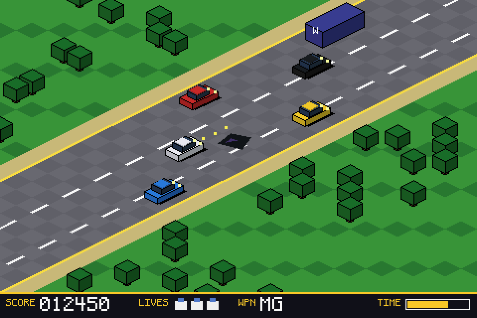
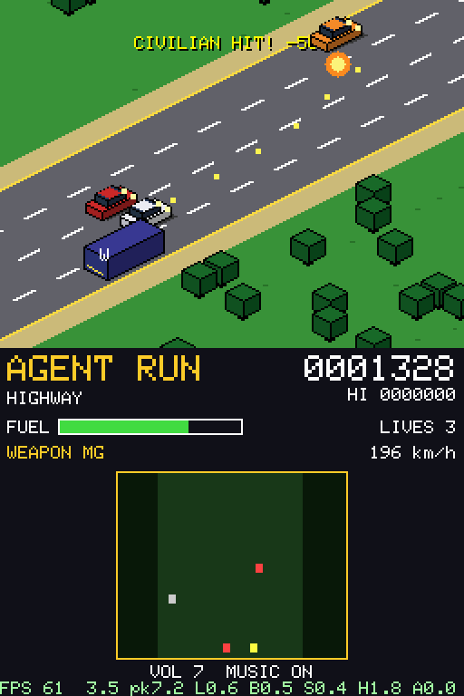
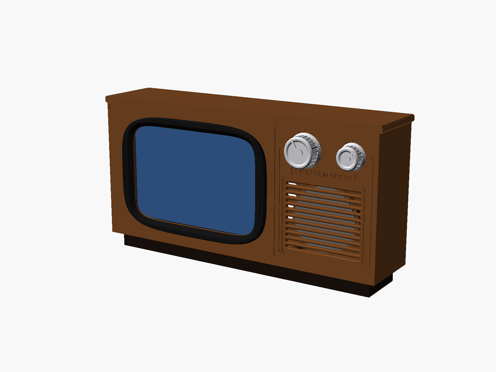
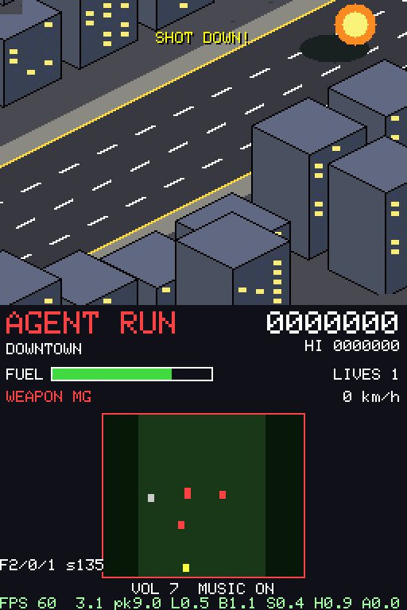
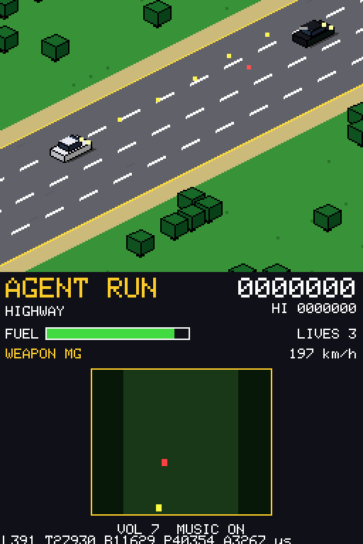
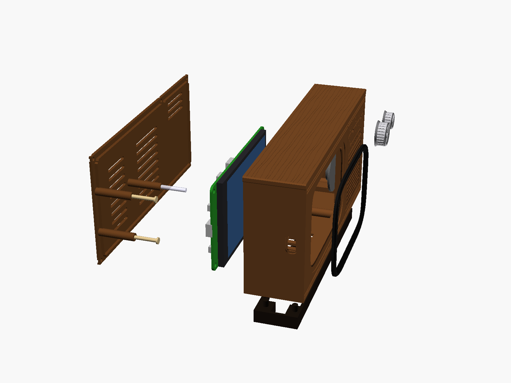
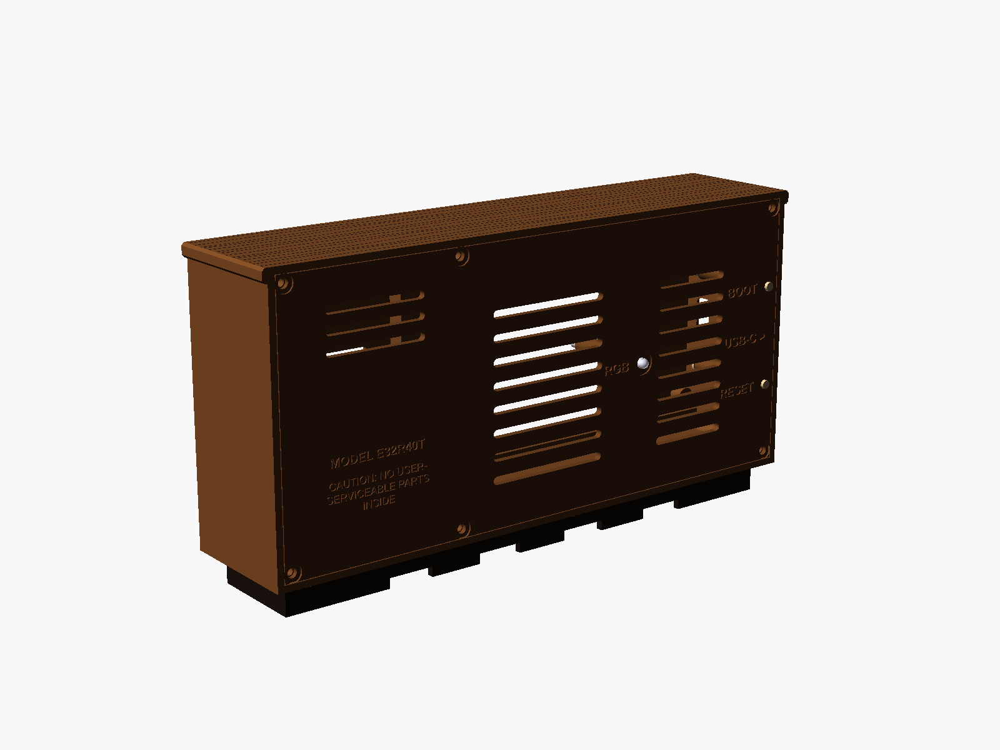
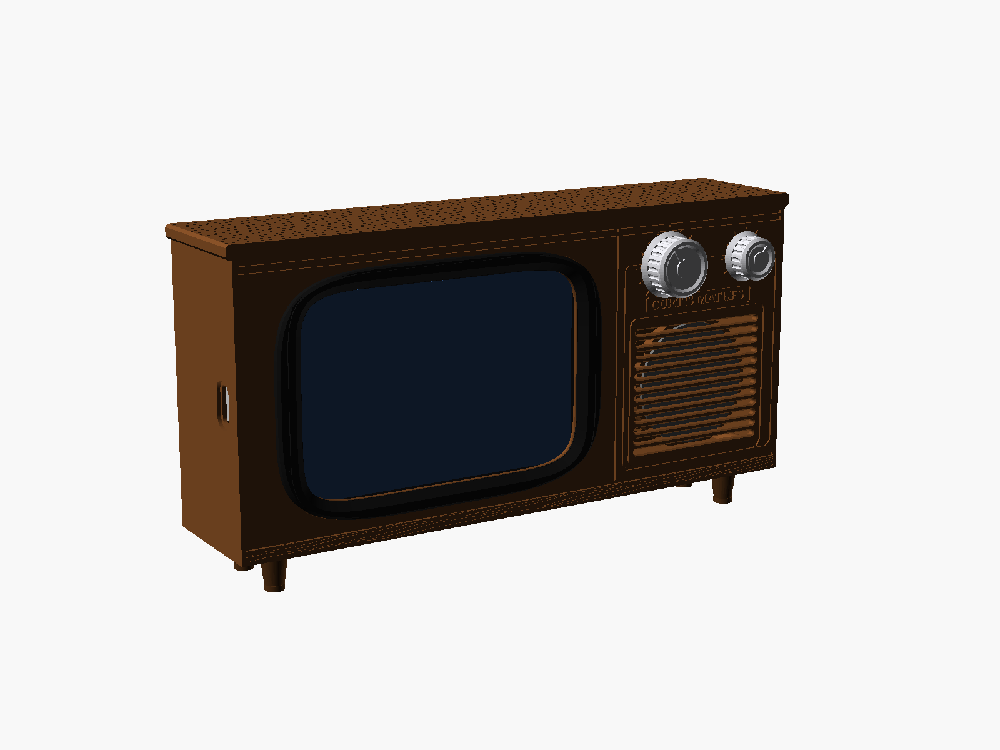

# AGENT RUN

<p align="center"></p>

> **One afternoon. Two platforms. One AI build partner.**
> William Morgan built AGENT RUN with his AI assistant, **Grok Bot**, in a single afternoon and evening. It covers an ESP32 handheld game, a 60 fps Nintendo DS port and a printable retro TV cabinet, in **roughly an hour and a half of AI build time**.

### ⏱️ Build timeline (Oct 17 2026, Central time)
*Times exclude William's hands-on flashing and testing.*

| Part | What got built | Time (CT) | Build time |
|---|---|---|---|
| **CYD** | Art mockups | 2:01–2:06 PM | ~5 min |
| | First compiled game with Bluetooth controller support | 2:08–2:15 PM | 7 min |
| | Blank-screen fix (first build confirmed working on hardware) | 2:25–2:30 PM | 5 min |
| | RGB LED + 8-bit sound and music | 4:40–4:44 PM | 4 min |
| **DS** | First `.nds`, including devkitPro setup | 7:53–8:05 PM | 12 min |
| | hbmenu launch fix | 9:22–9:33 PM | 11 min |
| | Performance rewrite, ~12 → 60 fps | 9:37–9:59 PM | 22 min |
| **Extras** | Retro Curtis Mathes-style console-TV enclosure | 7:58–8:17 PM | 19 min |
| | GitHub repo + write-up, then a secret scan (Oct 18) | — | ~2 min + ~1 min |

**CYD:** about 45 min of build time · **DS:** about 2 hours elapsed, ~45 min of build time · **Total:** roughly **1.5 hours** of AI build time.

---

**An isometric spy-car road game for the 4" ESP32 "Cheap Yellow Display", with a Nintendo DS port and a 3D-printable retro console-TV cabinet.**

You drive a white spy car up an endless isometric highway. You shoot enemy rammers and gunners, avoid civilians, grab weapons from the "W" van, and switch to a boat when the road runs out at the coast.
The ESP32 version is played with a Bluetooth gamepad through Bluepad32. The DS version uses the console's buttons and both screens.

> AGENT RUN is **inspired by** the arcade classic *Spy Hunter*. It is **not affiliated with, endorsed by or derived from** Spy Hunter or its rights holders. All code, graphics, sound effects and music (including the spy-jazz themes) are original.

| ESP32 CYD (mockup art, 480x320) | Nintendo DS (melonDS, 60 fps) | Cabinet |
|---|---|---|
|  |  |  |

---

## Contents
| Folder | What |
|---|---|
| [`cyd/`](cyd/) | ESP32 firmware: ESP-IDF + Arduino-as-component + Bluepad32, built with PlatformIO. Also an Arduino-IDE sketch variant. |
| [`ds/`](ds/) | Self-contained Nintendo DS/DSi/3DS homebrew port (devkitARM + libnds 2/calico). |
| [`enclosure/`](enclosure/) | Parametric OpenSCAD "1978 console TV" cabinet for the board: STLs, previews and a print/assembly guide. |
| [`tools/mockups/`](tools/mockups/) | Pillow scripts that generated the original art mockups. |
| [`docs/`](docs/) | Images, plus audio previews rendered from the game's synth (`docs/audio/*.wav`). |

Prebuilt binaries are on the [**v1.0 release**](https://github.com/williammorgansgrokbot/agent-run/releases/tag/v1.0):
* `agentrun-cyd4-merged.bin`: full ESP32 image, flash at **0x0**.
* `agentrun.nds`: DS ROM.

---

## Hardware (ESP32 version)
* **Board:** Hosyond 4.0" 320x480 ESP32-32E display, the same board as LCDWiki **E32R40T / E32N40T**.
  * ESP32-WROOM-32E (classic BT + BLE), 4 MB flash.
  * **ST7796S** 480x320 SPI panel, XPT2046 resistive touch (unused).
* **Controller:** any Bluepad32-supported gamepad. It was developed with a **JOWUA** multi-device controller in **S (Switch Pro)** mode.
* **Optional:** an 8 Ω speaker (28 to 40 mm) on the board's 1.25 mm 2-pin SPEAKER socket.

| Signal | GPIO | Notes |
|---|---|---|
| TFT SCLK / MOSI / MISO | 14 / 13 / 12 | HSPI native pins, 40 MHz (80 MHz usually works) |
| TFT CS / DC | 15 / 2 | |
| TFT RST | n/a | tied to EN |
| Backlight | 27 | active HIGH, switched on first thing in `app_main()` |
| Speaker | 26 | ESP32 DAC to the onboard FM8002E amp |
| Amp enable | 4 | active LOW; the amp is switched off when silent |
| RGB LED R / G / B | 22 / 16 / 17 | common anode, active LOW |

## Tech stack
* **ESP32:**
  * ESP-IDF 5.x with Arduino-as-component, from the [esp-idf-arduino-bluepad32-template](https://github.com/ricardoquesada/esp-idf-arduino-bluepad32-template).
  * [Bluepad32](https://github.com/ricardoquesada/bluepad32) + BTstack (BR/EDR + BLE).
  * [TFT_eSPI](https://github.com/Bodmer/TFT_eSPI) as an IDF component.
  * PlatformIO (pioarduino platform 55.03.31-2, PlatformIO Core 6.1.18).
* **DS:** devkitARM, libnds 2 (calico), libfat, ndstool. Tested in melonDS.
* **Shared game core:** the same C++ game logic and isometric renderer (`game_core.h`, `game_gfx.h`) and the same original songs on both platforms.
* **Enclosure:** OpenSCAD (manifold backend).
* **Art pipeline:** Python + Pillow mockups set the look before any firmware was written.

## How the isometric rendering works
* **Projection:** the world is a 2:1 isometric grid. `a` runs along the road and `b` across it, and screen = (`(a+b)·TILE_HW`, `(b−a)·TILE_HH − z`).
* **Sprites from boxes:** every sprite is drawn from flat-shaded `isoBox()` primitives. The top face is lit, the +b face is at 62 % brightness, the −a face at 80 %, and edges are outlined in black. Cars, vans, trees, mesas, skyscrapers and the helicopter are all composed this way, so there is no bitmap art at all.
* **Ground:** horizontal spans. Because the road runs exactly along the iso axis, each road band (verge, shoulder, edge line, asphalt) covers a constant span `x = OX + 2·TILE_HW·b − 2(y−OY)` on every scanline. The whole ground is a few `drawFastHLine` calls per row.
* **ESP32 frame pipeline:**
  * A full 480x320 framebuffer (300 KB) doesn't fit in RAM, so each frame is drawn into two 480x32 `TFT_eSprite` strips.
  * One strip is pushed over SPI DMA while the next is drawn.
  * Objects are depth-sorted (painter's algorithm on `b − a`) and only drawn into the strips they overlap.
* **Scenery:** generated by hashing tile coordinates, so it's deterministic, infinite and needs no map data.
* **Scenes:** HIGHWAY → NIGHT RUN (neon) → RIVER BRIDGE → CANYON SUNSET (mesas) → SNOW PASS → DOWNTOWN (bombing helicopter) → COAST (boat mode with torpedoes), then it loops.

## Controls and Bluetooth (ESP32)
| Action | Gamepad |
|---|---|
| Steer / speed | left stick or D-pad |
| Machine gun | A (bottom face button) or right trigger |
| Special weapon (oil / smoke / missile / torpedo) | B (or X) |
| Start / pause | Start |
| Music on/off | Select |
| Volume down / up | L1 / R1 (saved in NVS) |

**Pairing:**
* Power on the board; Bluepad32 scans automatically.
* **JOWUA:** set the Multi-Link switch to **S**, then hold **Pairing** for about 3 s until the 2nd LED flashes fast. It shows up as "Pro Controller".
* **Xbox / PS4 / PS5 / Switch Pro / 8BitDo:** use the normal pairing combo. There's a table in [`cyd/README.md`](cyd/README.md#pairing-a-controller).
* The title screen shows `PAD: <model>` when connected.
* Serial at 115200 baud logs the controller model, VID/PID and raw buttons.

## Nintendo DS version


* **Toolchain:** devkitARM + **libnds 2 / calico**. It builds as a DS+DSi hybrid ROM with an icon and title, and runs from TWiLight Menu++ or nds-hb-menu (DSi/3DS SD card, or a flashcart on an original DS).
* **Screens:** the top screen is the playfield. The bottom screen is the HUD: score, fuel, lives, weapon, speed, a radar and a live FPS/per-subsystem timing line.
* **The first port was a straight software renderer.** It ran at about 12 fps in melonDS and much slower on real hardware.
  * The DS's ARM9 runs at 67 MHz with no FPU.
  * Converting 2x256x192 frames per tick is too much for it.
* **The rewrite moves everything onto the 2D hardware:**
  * **BG3:** an 8bpp 512x256 *wrapping* bitmap holds the ground and scenery and is scrolled diagonally by hardware.
    * New content is rendered *ahead* of the camera, in five small clipped chunks spread over five frames.
    * The torus has 256 px horizontal / 64 px vertical off-screen slack, so the work stays off-screen.
  * **OAM sprites:** cars, bullets, helicopter, explosions and smoke are 8bpp hardware sprites. They are pre-rendered at each scene change *from the same `isoBox` drawing code*, so they look identical.
  * **BG0:** a tiled overlay for title, banner and game-over text, re-tiled only when the text changes.
  * **Integer / fixed-point hot paths:**
    * The ground uses span maths in (u = x+2y, v = x−2y) space.
    * Triangles use 16.16 fixed-point edges.
    * Colours are converted per primitive, never per pixel.
  * **Hardware audio:**
    * Lead: PSG 25 % square.
    * Bass: a looped 32-sample triangle PCM.
    * Drums: noise/PSG channels.
    * SFX: swept PSG + noise.
    * The ARM9 only steps a sequencer, so there's no per-sample synthesis.
* **Result:** frame time went from about **83 ms to about 3 ms** on average (peaks under 11 ms), i.e. **about 12 → 60 fps** in melonDS.

| Before (software renderer, ~12 fps) | After (2D hardware, 60 fps) |
|---|---|
|  |  |

**DS controls:**
* D-pad steers and sets speed.
* A/Y fire, B/X special weapon.
* START starts/pauses, SELECT toggles music, L/R set the volume.
* Saves (high score, volume, music) go to `sd:/agentrun.sav` in DSi mode, otherwise `fat:/agentrun.sav`.

## Cabinet
| | |
|---|---|
|  |  |
|  |  |

The cabinet is a wood-grain "1978 console TV" for the E32R40T.
* The board mounts landscape behind a squircle "CRT" window.
* There are chrome knobs, a speaker grille, and RESET/BOOT plungers plus an LED light pipe in the back panel.
* It's designed so every part prints without supports.
* See [`enclosure/README.md`](enclosure/README.md) for parts, print settings and assembly. It hasn't been test-printed yet.

## Challenges and fixes
* **Blank screen at boot.** On the first board revision the panel stayed dark.
  * Fix: identify the exact board (E32R40T pins differ from the 2.8" CYD) and set the pins.
  * Then switch on the **backlight (GPIO27) and display in `app_main()` before Bluetooth starts**. Bringing up BTstack first could stall long enough to look like a dead board.
  * Also remove `btstack_stdio_init()`, which hijacked the console.
  * The boot screen now says "Starting Bluetooth..." immediately.
* **Flash offset.** The merged image must be written at **0x0**, not 0x1000.
  * Flashing the merged binary at the bootloader offset produced a board that never booted.
  * When flashing separate files: bootloader at 0x1000, partitions at 0x8000, app at 0x10000.
  * A custom `partitions.csv` gives the app 3 MB.
* **Toolchain quirks.**
  * PlatformIO Core 6.2 pulls an SCons that breaks the platform, so it's pinned to **6.1.18**.
  * The game's `Input` struct clashed with an Arduino symbol (renamed `InState`).
* **"hbmenu doesn't see the ROM".** The copy on the user's machine was a **0-byte download**. Always check the file size after copying.
  * The ROM also got a proper icon and banner, and a verified header and CRC.
* **DS performance.** Fine in melonDS at first, very slow on hardware. Fixed by the hardware BG/OAM/PSG rewrite above, profiled with `cpuGetTiming()`.
* **libnds 2 / calico gotchas.**
  * Calico's low-level sound API hangs unless the driver is initialised via a libnds `soundPlay*` call first.
  * Replacing the VBlank IRQ handler interferes with calico.
  * The DS port uses the CPU timer for frame counting instead.

## Cool features
* Fully procedural isometric art: every sprite is code, so there are no bitmaps to ship.
* Original 8-bit spy-jazz soundtrack: a swung A-minor title theme, a 152 bpm E-minor walking-bass in-game theme, and a game-over phrase. Previews are in [`docs/audio/`](docs/audio/).
* The RGB LED flashes green per shot, red on a crash and blue on a pickup/boat. The controller rumbles on hits.
* Seven scenes, including a helicopter boss that only missiles can hit, and a boat section with torpedoes.
* The same game core runs on an ESP32 and a 2004 handheld.
* A 3D-printable faux-wood TV cabinet.

## Status and known issues
* **ESP32 firmware:**
  * Complete and played on real hardware: display, Bluetooth controller, LED, sound, saves.
  * Frame rate is bound by the SPI clock: about 16 fps at the default 40 MHz, up to about 30 fps at 80 MHz.
  * The source in `cyd/` is the version restored after an earlier workspace reset. It matches the v1.0 binary's feature set, but if you change anything, rebuild from source rather than trusting the old binary.
  * The Arduino-IDE variant (`cyd/arduino/`) hasn't been compile-tested.
* **DS port:**
  * Runs at 60 fps in melonDS.
  * **Real-hardware speed after the rewrite, DSi-mode boot, and the hardware-channel audio mix are not yet confirmed** on a physical console.
  * Cars always draw over scenery, so in the city they can appear in front of skyscrapers. Screen shake moves only sprites.
* **Enclosure:** fit-checked numerically against the board's STEP model, but not yet printed.

## Building and flashing
**ESP32: flash the prebuilt image.**
```bash
esptool.py --chip esp32 -b 921600 write_flash 0x0 agentrun-cyd4-merged.bin
```
You can also use https://espressif.github.io/esptool-js/ at offset **0x0**. Hold BOOT if the board won't connect.

**ESP32: build from source.**
```bash
pip install "platformio==6.1.18"
cd cyd && ./setup_deps.sh          # fetches Bluepad32, Arduino core, BTstack, TFT_eSPI (not committed)
pio run -e esp32dev -t upload && pio device monitor -b 115200
```

**DS:**
1. Copy `agentrun.nds` to the SD card or flashcart.
2. Check its size (about 350 KB).
3. Launch it from TWiLight Menu++ (recommended on DSi/3DS) or the latest nds-hb-menu.

To build, install devkitPro (`nds-dev`), then `cd ds && make`. `make EXTRA_CFLAGS=-DAR_DEMO` builds a self-playing demo.

**Enclosure:** print the STLs in `enclosure/stl/`. To re-export them, run `OPENSCAD=openscad ./export_stl.sh`.

## Licence
* The project code, art, music and enclosure are under the **MIT** licence (see [LICENSE](LICENSE)).
* Third-party libraries keep their own licences. They are fetched at build time, not vendored:
  * Bluepad32 (Apache-2.0)
  * BTstack (its own licence; non-commercial use is free)
  * Arduino-ESP32 (LGPL-2.1)
  * TFT_eSPI (FreeBSD/MIT mix; the 5x7 font in `ds/source/glcdfont.h` comes from Adafruit-GFX via TFT_eSPI, BSD)
  * libnds/calico (zlib)
  * See [`cyd/THIRD_PARTY_LICENSES.txt`](cyd/THIRD_PARTY_LICENSES.txt).
* *Spy Hunter* is a trademark of its respective owner. This project is an independent homage.
